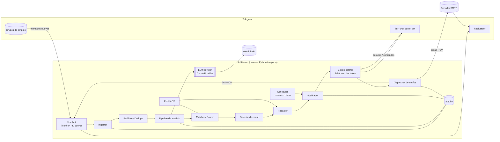

# 02 — Arquitectura

## Idea clave: dos clientes de Telegram

Telegram distingue entre **cuentas de usuario** y **bots**, y cada una cubre una parte del sistema:

| Cliente | Tipo | Para qué | Por qué |
|---------|------|----------|---------|
| **Userbot** | Tu cuenta personal (API MTProto, `api_id`/`api_hash`) | Leer los grupos y enviar DMs a los reclutadores | Un bot no puede leer grupos a los que no lo han añadido, ni escribir primero a un usuario. Tu cuenta sí. |
| **Bot de control** | Bot creado con @BotFather (token) | Tu interfaz: notificaciones, botones y comandos | Separa tu chat de control de tu cuenta personal y permite botones inline. |

Ambos clientes se ejecutan con **Telethon** en el mismo proceso y el mismo event loop de asyncio.

## Diagrama de componentes

## Componentes

| Componente | Responsabilidad |
|------------|-----------------|
| **Userbot** | Sesión de Telethon con tu cuenta. Se suscribe a `events.NewMessage(chats=grupos)`, hace el escaneo histórico (`iter_messages`), resuelve usuarios y envía DMs y archivos. |
| **Bot de control** | Sesión de Telethon como bot. Maneja comandos (`/start`, `/cv`, …) y `CallbackQuery` de los botones. Filtra por `OWNER_USER_ID`. |
| **Ingestor** | Normaliza el mensaje (texto, entidades, autor, enlace `t.me/c/...`) y lo guarda en `raw_messages`. |
| **Prefiltro + Dedupe** | Reglas baratas: longitud mínima, palabras clave de empleo, palabras excluidas e idioma. Hash del texto normalizado para detectar duplicados exactos y similitud para casi-duplicados. |
| **Pipeline de análisis** | Orquesta: clasificar, extraer, aplicar reglas duras, puntuar, elegir canal y redactar. Usa una cola `asyncio.Queue` con N workers para no saturar el LLM. |
| **LLMProvider** | Interfaz abstracta (`generate_json`, `generate_text`). La implementación inicial es `GeminiProvider` con el SDK `google-genai` y salida JSON con esquema. |
| **Matcher / Scorer** | Combina reglas deterministas (deal-breakers, bonificaciones) con la puntuación del LLM. |
| **Selector de canal** | Decide entre email, DM o manual a partir de la extracción (ver [03](03-flujos.md#selección-de-canal)). |
| **Redactor** | Genera el borrador (asunto y cuerpo) en el idioma de la oferta, respetando sus instrucciones. Regenera o ajusta según tus instrucciones. |
| **Notificador** | Construye las tarjetas, decide inmediato o resumen y envía por el bot. |
| **Dispatcher de envíos** | Ejecuta los envíos aprobados respetando límites, espaciado y reintentos. Registra el resultado. |
| **Scheduler** | APScheduler (`AsyncIOScheduler`): resumen diario, limpieza y recordatorios de "⏰ Más tarde". |
| **Perfil / CV** | Carga el PDF, extrae el texto con `pypdf`, genera el perfil estructurado con el LLM y lo guarda. |

## Stack tecnológico

| Área | Elección | Notas |
|------|----------|-------|
| Lenguaje | Python 3.13 (compatible ≥ 3.12) | Fijado con `.python-version`; la imagen Docker usa `python:3.13-slim`. |
| Gestor de paquetes | `uv` | `pyproject.toml` + `uv.lock`. |
| Telegram | `telethon` | Userbot y bot con la misma librería. |
| LLM | `google-genai` | `gemini-3.5-flash` con respaldo `gemini-3.5-flash-lite` (configurable, ver ADR-012). |
| Validación / config | `pydantic` v2, `pydantic-settings` | Modelos de dominio, esquemas del LLM y config desde `.env` y YAML. |
| Base de datos | SQLite + `aiosqlite` (o SQLAlchemy 2 async) | Archivo local `data/jobhunter.db`. |
| PDF | `pypdf` | Extracción de texto del CV. |
| Email | `aiosmtplib` + `email.message` | Gmail con contraseña de aplicación u otro SMTP. |
| Planificación | `apscheduler` | Resumen diario. |
| Similitud | `rapidfuzz` | Detección de casi-duplicados. |
| Detección de idioma | `langdetect` o el propio LLM | Opcional en el prefiltro. |
| Logs | `structlog` o `logging` estándar | JSON en archivo y texto legible en consola. |
| Tests | `pytest`, `pytest-asyncio` | LLM y Telegram mockeados. |
| Despliegue | `systemd` o Docker | Ver [07](07-configuracion.md). |

## Principios de diseño

1. **Humano en el bucle:** ninguna acción hacia fuera (DM o email) sin aprobación explícita.
2. **Barato primero:** reglas y caché antes que el LLM; el LLM solo procesa lo que pasa el prefiltro.
3. **Idempotencia:** cada mensaje y cada oferta tienen una clave única; reprocesar no duplica notificaciones ni envíos.
4. **Proveedores intercambiables:** `LLMProvider`, `Sender` (Telegram/Email) y `Repository` son interfaces.
5. **Estado persistente:** cualquier reinicio continúa donde se quedó (ofertas pendientes, envíos en cola).
6. **El texto de las ofertas no es de confianza:** se trata como dato, nunca como instrucción. No puede cambiar el comportamiento de la IA, su prompt ni la configuración base (ver [08 §4](08-seguridad-y-riesgos.md#4-aislamiento-de-la-ia-prompt-injection)).
7. **Visibilidad del riesgo:** el chat muestra siempre cuántos usuarios nuevos se han contactado hoy (ver [08 §1](08-seguridad-y-riesgos.md#contador-de-usuarios-nuevos-contactados)).
