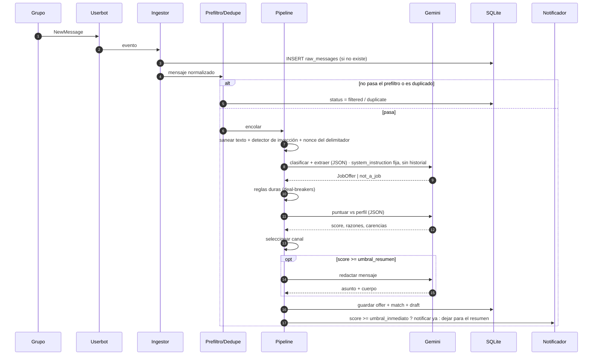
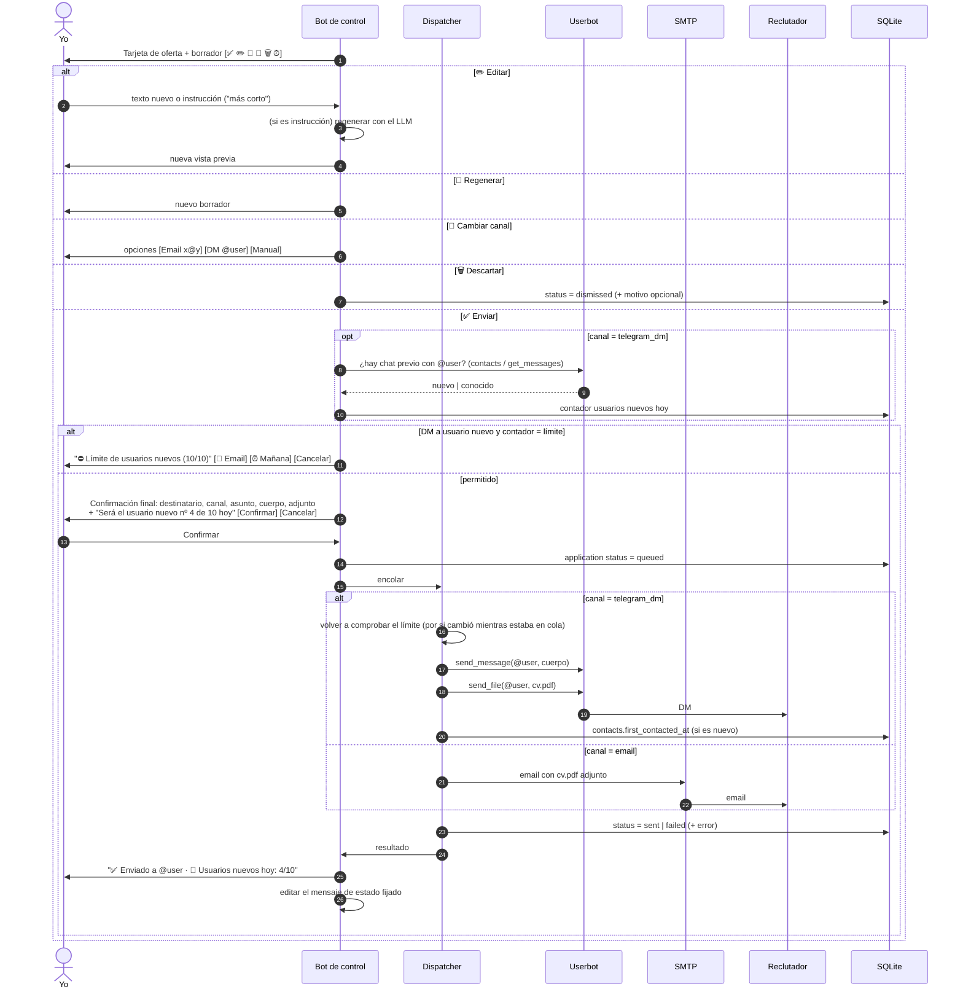
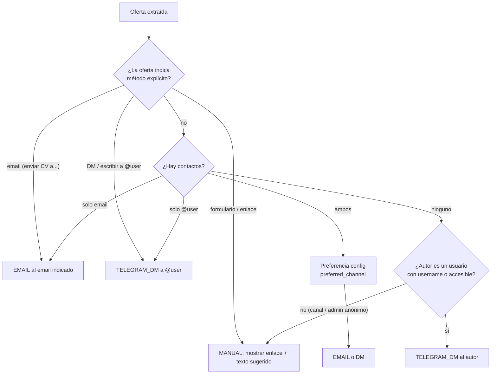
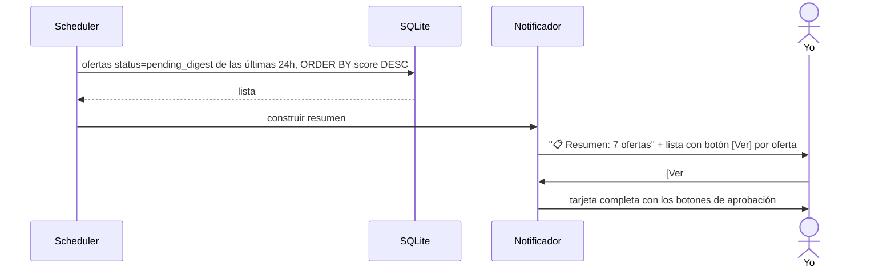

# 03 — Flujos

## 1. Ingesta y análisis de un mensaje nuevo

**Nota de optimización:** la clasificación y la extracción se hacen en **una sola llamada** al LLM (el esquema incluye `is_job_offer`). La puntuación es una segunda llamada, y la redacción una tercera solo si la puntuación lo merece.

## 2. Aprobación y envío

## Selección de canal

Entrada: la extracción del LLM (`contacts.emails`, `contacts.telegram_usernames`, `contacts.urls`, `application_instructions`, `preferred_channel_stated`) y el autor del mensaje.

Reglas adicionales:
- Los emails extraídos se validan con regex y además **deben aparecer literalmente en el texto original** (protege contra alucinaciones del LLM). Lo mismo con los `@usuarios`.
- Si el destinatario resuelto por DM es un bot, un canal o no existe, se pasa a manual y se te avisa.
- El canal elegido y el **motivo** se muestran en la tarjeta ("📧 Email — la oferta dice 'enviar CV a jobs@acme.com'").

## 3. Resumen diario

- Hora configurable (`digest.time`, por defecto `09:00` en `TZ`).
- Si no hay ofertas, no se envía nada (o un mensaje breve, configurable).
- Las ofertas "⏰ Más tarde" vuelven en el siguiente resumen.

## 4. Carga y actualización del CV

1. Envías el PDF al bot (o ejecutas `/cv` y lo adjuntas).
2. El bot guarda el archivo en `data/cv/cv.pdf` (versionando el anterior).
3. Extrae el texto con `pypdf`. Si sale vacío (PDF escaneado), te avisa: haría falta OCR o un `.txt` complementario.
4. El LLM genera un `CandidateProfile` (JSON) y el bot te lo muestra para confirmar o corregir.
5. Al confirmar, se invalida la caché de puntuaciones y puedes reevaluar las ofertas recientes con `/reevaluar`.

## 5. Escaneo histórico

`/escanear 7` recorre con `iter_messages` los últimos 7 días de cada grupo, de forma pausada (respetando `FloodWait`), y pasa los mensajes por el mismo pipeline. Las ofertas encontradas van al resumen, salvo las de puntuación muy alta, que se notifican agrupadas para no inundar el chat.

## 6. Arranque y recuperación

1. Cargar la config y validar las credenciales.
2. Conectar el userbot y el bot.
3. Reencolar los mensajes que quedaron en `status = processing` y los envíos en `queued`.
4. Opcional: "catch-up" de los mensajes publicados mientras el bot estaba apagado (desde el último `message_id` visto por grupo).
5. Cargar los prompts (solo lectura) y registrar su hash.
6. Recalcular el contador de usuarios nuevos del día desde la BD y actualizar (o crear y fijar) el mensaje de estado.
7. Enviarte "🟢 JobHunter en línea — escuchando N grupos".

## 7. Contador diario

- El scheduler, a las 00:00 (`TZ`), edita el mensaje de estado fijado para mostrar `👤 Usuarios nuevos: 0/10`.
- El contador no se guarda como número suelto: siempre se **calcula** desde `contacts`, así que no se desincroniza tras un reinicio.
