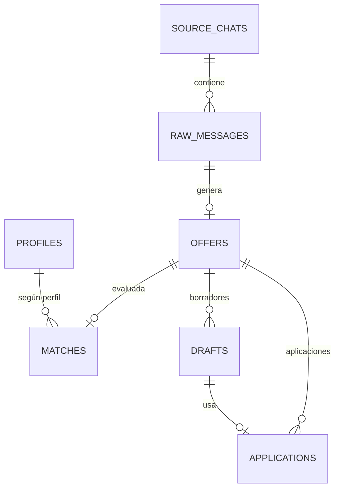
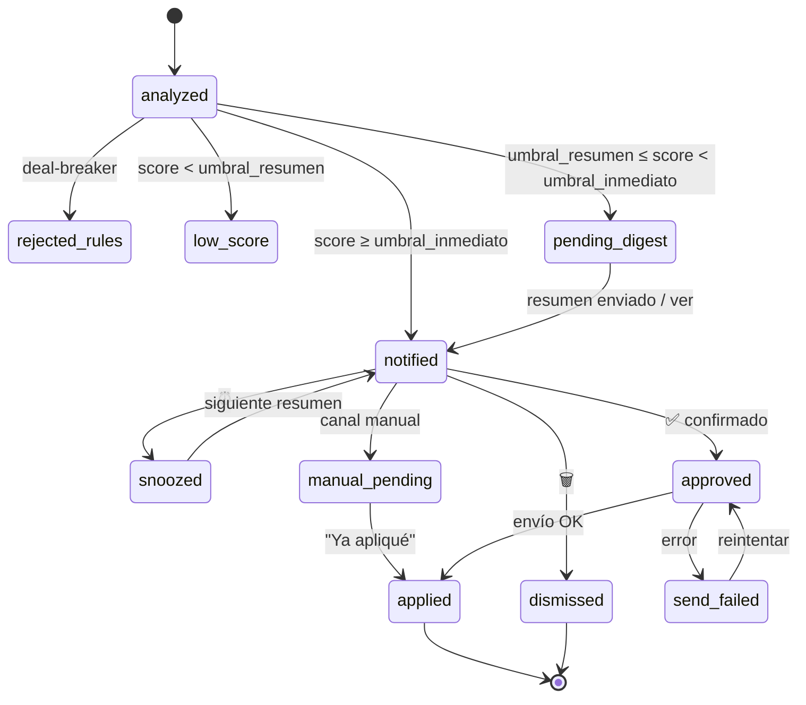

# 04 — Modelo de datos

Base de datos SQLite en `data/jobhunter.db`. Las migraciones se gestionan con scripts SQL numerados (`migrations/001_init.sql`, …) o con Alembic si se usa SQLAlchemy.

## Diagrama ER



## Tablas

### `source_chats`
Grupos y canales monitorizados.

| Columna | Tipo | Notas |
|---------|------|-------|
| id | INTEGER PK | Peer ID de Telegram del chat (`-100…` para canales y supergrupos) |
| title | TEXT | |
| username | TEXT NULL | |
| kind | TEXT | `group` o `channel` |
| enabled | BOOLEAN | Pausado o activo (desde `/grupos`) |
| last_message_id | INTEGER | Para el catch-up tras un reinicio |
| last_message_at | DATETIME NULL | |
| added_at | DATETIME | |

Solo se escribe desde el bot (`/grupos`, `/grupo_add`, reenvío de mensaje).

### `raw_messages`
Todo mensaje recibido de los grupos monitorizados.

| Columna | Tipo | Notas |
|---------|------|-------|
| id | INTEGER PK | |
| chat_id | INTEGER | Sin FK: quitar un grupo no borra su historial |
| message_id | INTEGER | UNIQUE(chat_id, message_id) |
| sender_id | INTEGER NULL | |
| sender_username | TEXT NULL | |
| sender_name | TEXT NULL | |
| sender_is_user | BOOLEAN | False si es un canal, admin anónimo o bot |
| text | TEXT | Texto completo (incluye los pies de foto) |
| hidden_urls | JSON | Enlaces ocultos tras texto (entidades `TextUrl`) |
| link | TEXT NULL | `https://t.me/c/<id>/<msg>` o `t.me/<username>/<msg>` (NULL en grupos básicos) |
| text_norm | TEXT | Texto normalizado (sin tildes, emojis ni formato) |
| text_hash | TEXT | SHA-256 de `text_norm` (+ enlaces ocultos) |
| status | TEXT | `new` (pendiente de analizar), `filtered`, `duplicate`, `processing`, `not_job`, `processed`, `error` |
| filter_reason | TEXT NULL | Motivo del filtro, "duplicado de #N" o por qué la IA dice que no es oferta |
| attempts | INTEGER | Análisis fallidos por IA saturada (a los 3 → `error`) |
| error | TEXT NULL | Último error de análisis |
| duplicate_of | INTEGER NULL | Mensaje original si es duplicado |
| posted_at | DATETIME | |
| created_at | DATETIME | |

Deduplicación (fase 1): hash exacto y, si no coincide, casi-duplicado con `rapidfuzz.ratio ≥ dedupe.similarity_threshold` (92) contra los originales de los últimos `dedupe.window_days` (14). Los mensajes filtrados nunca cuentan como originales.

### `offers`
Una por mensaje analizado que la IA considera oferta (`raw_message_id` único). La deduplicación se hace antes, a nivel de mensaje (hash + casi-duplicados), así que no hay `fingerprint` ni `offer_sightings` en v1.

| Columna | Tipo | Notas |
|---------|------|-------|
| id | INTEGER PK | |
| raw_message_id | INTEGER FK | Primer avistamiento |
| title | TEXT | |
| company | TEXT NULL | |
| seniority | TEXT NULL | `junior`, `mid`, `senior`, `lead`, … |
| stack | JSON | `["python","django","aws"]` |
| modality | TEXT NULL | `remote`, `hybrid`, `onsite` |
| location | TEXT NULL | |
| salary_min / salary_max | REAL NULL | |
| salary_currency / salary_period | TEXT NULL | |
| contract_type | TEXT NULL | |
| language | TEXT | Idioma del texto de la oferta (`es`, `en`) |
| contacts | JSON | Contactos **validados** `{emails:[], usernames:[], urls:[]}` |
| application_instructions | TEXT NULL | Instrucciones literales para aplicar |
| injection_suspected | BOOLEAN | Detector determinista o `manipulation_attempt` del LLM |
| injection_signals | JSON | Patrones detectados (para mostrar la alerta) |
| summary | TEXT | Resumen de 1-2 frases |
| rejections | JSON | Motivos si la descartaron las reglas duras |
| model | TEXT | Modelo que hizo la extracción |
| extraction | JSON | Respuesta completa del LLM (auditoría) |
| status | TEXT | Ver la máquina de estados |
| created_at / updated_at | DATETIME | |

### `profiles`
Versiones del perfil del candidato.

| Columna | Tipo | Notas |
|---------|------|-------|
| id | INTEGER PK | |
| cv_path | TEXT | `data/cv/incoming/…` mientras es borrador; `data/cv/cv.pdf` al activarse |
| cv_text | TEXT | Texto extraído (+ enlaces del PDF), tal como se envía a la IA |
| cv_sha256 | TEXT | |
| profile | JSON | `CandidateProfile` |
| status | TEXT | `draft`, `active` (máx. uno, índice único), `archived`, `discarded` |
| model | TEXT | Modelo de IA que generó el perfil |
| created_at / confirmed_at | DATETIME | |

Las preferencias de búsqueda no van aquí: están en `config.yaml` y en la tabla `settings`.

### `matches`
| Columna | Tipo | Notas |
|---------|------|-------|
| id | INTEGER PK | |
| offer_id | INTEGER FK | |
| profile_id | INTEGER FK | UNIQUE(offer_id, profile_id) |
| score | INTEGER | 0–100 final |
| llm_score | INTEGER | Puntuación bruta del LLM |
| verdict | TEXT | `strong`, `good`, `weak`, `no` |
| rule_adjustments | JSON | `[{"rule":"remote_bonus","delta":5}]` |
| reasons | JSON | Por qué encaja |
| gaps | JSON | Qué falta |
| red_flags | JSON | |
| pitch_points | JSON | Qué destacar en el mensaje |
| channel | TEXT | `email`, `telegram_dm`, `manual` |
| channel_target | TEXT | Email o @usuario o ID |
| channel_reason | TEXT | Explicación mostrada al usuario |
| channel_options | JSON | Canales posibles para 📨 `[{kind, target, label}]` |
| model | TEXT | Modelo usado |
| created_at | DATETIME | |

### `drafts`
| Columna | Tipo | Notas |
|---------|------|-------|
| id | INTEGER PK | |
| offer_id | INTEGER FK | |
| version | INTEGER | 1, 2, 3… |
| channel | TEXT | |
| target | TEXT NULL | Destinatario cuando se redactó |
| subject | TEXT NULL | Solo email |
| body | TEXT | |
| origin | TEXT | `llm`, `llm_instruction`, `user_edit` |
| instruction | TEXT NULL | "más corto…" |
| warnings | JSON | Avisos de la validación (contactos ajenos) |
| model | TEXT NULL | |
| created_at | DATETIME | |

### `applications`
| Columna | Tipo | Notas |
|---------|------|-------|
| id | INTEGER PK | |
| offer_id | INTEGER FK | |
| draft_id | INTEGER FK | Versión exacta enviada |
| channel | TEXT | |
| target | TEXT | |
| attachment_path | TEXT | |
| status | TEXT | `queued`, `sending`, `sent`, `failed`, `cancelled` |
| dry_run | BOOLEAN | Simulación (no llegó al reclutador) |
| bot_message_id | INTEGER NULL | Confirmación en tu chat (se edita con el resultado) |
| replied_at | DATETIME NULL | El reclutador respondió por DM (fase 4) |
| follow_up_done | BOOLEAN | Recordatorio de seguimiento ya enviado |
| error | TEXT NULL | |
| external_id | TEXT NULL | ID del mensaje de Telegram o Message-ID del email |
| contact_id | INTEGER FK NULL | Solo para `telegram_dm` |
| was_new_contact | BOOLEAN NULL | True si este envío fue el primer contacto con ese usuario |
| approved_at | DATETIME | |
| sent_at | DATETIME NULL | |

### `contacts`
Usuarios de Telegram a los que se ha escrito (o que se han comprobado). Es la base del **contador de usuarios nuevos**.

| Columna | Tipo | Notas |
|---------|------|-------|
| id | INTEGER PK | |
| tg_user_id | INTEGER UNIQUE | |
| display_name | TEXT NULL | |
| username | TEXT NULL | |
| had_prior_chat | BOOLEAN | Ya existía un chat privado antes de que el bot le escribiera |
| first_contacted_at | DATETIME NULL | Primer DM enviado por el bot cuando **no** había chat previo; es lo que cuenta en el contador |
| last_contacted_at | DATETIME NULL | |
| dm_count | INTEGER | |

Contador del día:
```sql
SELECT COUNT(*) FROM contacts
WHERE had_prior_chat = 0
  AND first_contacted_at >= :inicio_dia_local AND first_contacted_at < :fin_dia_local;
```

### Mensaje de estado fijado
Su id se guarda en `settings` (`status_message.bot_message_id`). El día con PeerFlood se guarda en `sending.peer_flood_day`.

### `bot_messages`
Mapea los mensajes que el bot te envió con la oferta correspondiente (para editar tarjetas y resolver callbacks).

| Columna | Tipo |
|---------|------|
| bot_message_id | INTEGER PK |
| offer_id | INTEGER FK |
| kind | TEXT (`card`, `digest`, `preview`, `confirm`) |

### `settings`
Clave-valor para las preferencias editables desde el bot (sobrescriben a `config.yaml`). **Solo la escriben los handlers de comandos del propietario**; el pipeline de análisis tiene acceso de solo lectura (ver [08 §4](08-seguridad-y-riesgos.md#4-aislamiento-de-la-ia-prompt-injection)).

## Máquina de estados de una oferta



## Retención
- `raw_messages` con `status in (filtered, not_job)`: se borran a los 30 días (configurable).
- Ofertas y aplicaciones: se conservan indefinidamente (historial).
